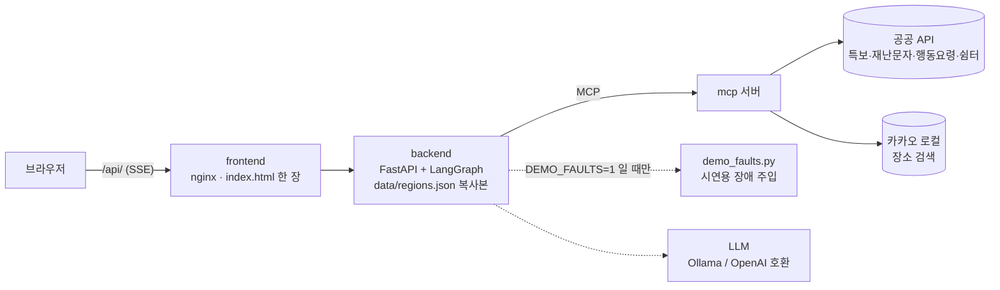
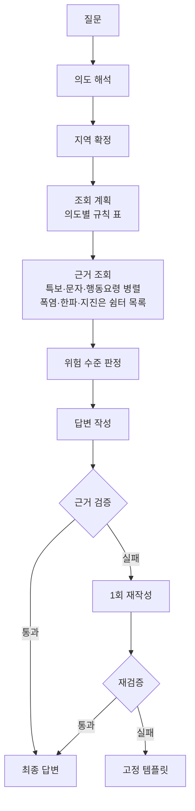

# disaster-advisor — 재난문자 모아보기 · "문자 받았는데 뭘 해야 하나요?"

재난문자를 받고 당황한 시민에게, 우리 동네의 **기상특보·긴급재난문자를 한곳에 모아 보여 주고 공식 행동요령을 근거와 함께 안내**하는 AI 에이전트입니다. 공식 데이터만 근거로 삼고, 근거 검증을 통과한 답변만 내보내도록 설계했습니다. 현재 지원 범위는 광주광역시와 경기도 광주시이며, 전국 확대를 준비하고 있습니다.

> 이 서비스는 공식 경보 채널이 아닙니다. 실제 위급 상황에서는 재난문자, 방송, 119 등 공식 안내를 따르세요. 조회에 실패하거나 공식 데이터에 없는 내용은 "정보 없음"으로 표시하며, 이는 안전하다는 뜻이 아닙니다.

## 하는 일
- 지역을 말하면 **발효 중인 특보와 최근 긴급재난문자**를 공식 API로 조회해 위험 수준을 판정합니다.
- 재난 유형에 맞는 **공식 행동요령**을 근거 번호(`[E#]` 특보, `[M#]` 문자, `[G#]` 행동요령)와 함께 보여 줍니다.
- 장소 이름을 말하면 지역을 찾고 카카오맵 링크 칩을 붙입니다(경로 안내·안전 경로 판단은 하지 않습니다).
- 조회 실패와 "해당 지역 정보 없음"을 구분하고, 근거 없는 문장은 검증 단계에서 차단합니다.


## 구조


**판정·라우팅·조회 계획·검증은 코드가, LLM은 의도 파악과 답변 작성만** 맡습니다. API 키는 `mcp` 컨테이너에만 전달되고 서버는 상태를 저장하지 않습니다.

### 응답 순서

- 화면은 SSE 이벤트를 네 단계로 보여 줍니다: **판단**(`judgement`, 지역·위험 수준) → **근거**(`evidence`, 공식 데이터 묶음) → **빠른 답**(`quick`, 검증을 통과한 기본 요약) → **최종 답**(`final`, AI 답변이 검증을 통과하면 교체). 진행 문구는 `progress`, 노드별 시간·분기·장애 주입은 화면의 "개발자 보기"에만 있습니다.
- 백엔드 이미지는 범위 판단용으로 `data/regions.json`만 복사합니다. 시연용 장애 주입(`backend/agent/demo_faults.py`)은 `DEMO_FAULTS=1`일 때만 켜집니다(기본 꺼짐, ADR-021).
- 응급 상황과 범위 밖 질문은 고정 응답으로 분기합니다. 지역은 전국 시·군으로 해석하고(광역시는 시 전체 단위), 같은 이름이 여러 곳이거나 도 이름만 있으면 되묻습니다('광주'는 두 곳을 함께 보여 줍니다).
- 쉼터·대피장소는 공식 목록에 있는 장소로만 안내하고 운영 여부는 단정하지 않습니다. 지도는 카카오맵 링크로만 넘깁니다.
- 설계 배경과 결정 기록은 [`doc/기획서.md`](doc/기획서.md), [`doc/ADR.md`](doc/ADR.md), 문제 해결 기록은 [`doc/트러블슈팅.md`](doc/트러블슈팅.md)에 있습니다.

## 실행
준비물: Docker, (선택) 로컬 LLM용 Ollama.

```bash
cp .env.example .env        # 값 채우기 (.env는 커밋하지 않습니다)
docker compose up --build   # http://localhost:8080
```

실행 방식은 두 가지를 따로 고릅니다.

**1) 데이터: replay와 live** — 화면의 "데이터" 선택(또는 `.env`의 `DATA_MODE`)으로 정합니다.

| 모드 | 하는 일 | 공공 API 키 | 용도 |
|---|---|---|---|
| `replay` (기본) | 저장해 둔 실제 API 응답(`data/fixtures/`)을 다시 읽음 | **필요 없음**, 호출 한도도 쓰지 않음 | 처음 실행해 보기, 시연, 평가. 정해진 지역·날짜(광주 두 곳 등)의 상황을 재현 |
| `live` | 지금 이 순간의 공공 API를 직접 호출 | 필요 | 실제 현재 특보 조회 |

**2) 답변을 쓰는 LLM** — 데이터 모드와는 별개이며 `.env`의 `LLM_*`로 정합니다.
- `LLM_BACKEND=fake`(기본): 모델 없이 고정 규칙으로 답을 만드는 테스트 모드. 코드가 제대로 도는지 확인하는 용도입니다.
- `LLM_BACKEND=openai_compat`: 실제 모델 사용(예: 로컬 Ollama의 `qwen3:8b`). 설정은 아래 [부록 3](#3-llm-연결)을 보세요.

**가장 빠른 시작:** 키를 하나도 채우지 않고 위 두 줄만 실행하면 `replay` + `fake`로 뜹니다. 실제 모델 답변을 보려면 Ollama를 켜고 `LLM_BACKEND`와 `LLM_MODEL`만 채우면 되고, 현재 특보를 보려면 공공 API 키를 채운 뒤 `live`를 선택합니다. 키 목록은 [부록 1](#1-필요한-키--데이터가-얼마나-흩어져-있는가)과 [`doc/환경변수.md`](doc/환경변수.md)에 있습니다.

단위 테스트와 평가 세트가 있습니다.
```bash
sh/setup_venv.sh && sh/test.sh        # 단위 테스트
.venv/bin/python eval/run_eval.py     # 평가 세트
.venv/bin/python eval/run_scenarios.py [--live]   # 시연 시나리오
```

## 폴더
| 경로 | 내용 |
|---|---|
| `backend/` | FastAPI, LangGraph 에이전트(판정·검증 포함) |
| `mcp_server/` | MCP 서버: 공공 API 접근, 지역 해석, 쉼터 목록, 카카오 장소 조회 (`tools/`: 지역 데이터 생성) |
| `config/`, `prompts/` | 설정, 규칙, 프롬프트와 고정 문구 |
| `data/` | 지역(전국 생성본)·재난 유형 매핑, 특보구역표, 특보·문자·행동요령·쉼터 fixture |
| `eval/` | 평가 세트와 실행기 |
| `frontend/` | 정적 웹 UI |
| `doc/` | 기획서, ADR, API 스키마, 운영 문서 |

## 데이터 출처
- 기상청 기상특보 조회서비스 (공공데이터포털)
- 행정안전부 긴급재난문자, 국민행동요령(자연·사회·생활안전·민방위), 통합대피소 (재난안전데이터공유플랫폼)
- 카카오 로컬 API (장소 검색, 응답은 저장하지 않음)

각 데이터의 이용조건은 제공기관 표기를 따릅니다. 긴급재난문자는 출처표시·상업적 이용 금지·변경 금지 조건이 있어, 이 저장소는 API 활용신청 때 밝힌 대로 **학습용(비상업)** 프로젝트입니다.

## 부록. 포팅 방법

### 1. 필요한 키 — 데이터가 얼마나 흩어져 있는가
시민이 문자를 받고 행동을 알아내는 데 필요한 공식 정보는 **발급처 3곳, API 8개, 키 8개**로 나뉘어 있습니다. 이 프로젝트가 한 번의 질문으로 합치는 대상입니다.

| 환경변수 | 발급처 | 용도 |
|---|---|---|
| `WEATHER_ALERTS_SERVICE_KEY` | 공공데이터포털 | 기상특보 |
| `DSSP_MESSAGE_SERVICE_KEY` | 재난안전데이터공유플랫폼 | 긴급재난문자 |
| `DSSP_GUIDE_NATURAL_SERVICE_KEY` | 재난안전데이터공유플랫폼 | 행동요령 · 자연재난 |
| `DSSP_GUIDE_SOCIAL_SERVICE_KEY` | 재난안전데이터공유플랫폼 | 행동요령 · 사회재난 |
| `DSSP_GUIDE_LIFE_SERVICE_KEY` | 재난안전데이터공유플랫폼 | 행동요령 · 생활안전 |
| `DSSP_GUIDE_CIVIL_DEFENSE_SERVICE_KEY` | 재난안전데이터공유플랫폼 | 행동요령 · 민방위 |
| `DSSP_SHELTER_SERVICE_KEY` | 재난안전데이터공유플랫폼 | 통합대피소 |
| `KAKAO_REST_API_KEY` | 카카오 디벨로퍼스 | 장소 검색 |

8개 모두 서로 다른 키입니다. 선택 항목: `LANGSMITH_*`(관측성), `LLM_*`(모델).

### 2. Docker로 실행
```bash
git clone https://github.com/DDARK00/disaster-alert-agent.git && cd disaster-alert-agent
cp .env.example .env         # 위 키를 채운다
docker compose up --build    # http://localhost:8080
```
- 컨테이너 3개: `mcp`(:8200), `backend`(:8100), `frontend`(:8080). 키는 `mcp`에만 전달됩니다.
- 상태 확인: `http://localhost:8080/api/health`
- `./data`가 `mcp`에 마운트되어, 수집한 fixture가 호스트에 남습니다.

### 3. LLM 연결
`LLM_BACKEND=openai_compat`은 OpenAI 모델을 쓴다는 뜻이 아니라 **OpenAI 호환 API 형식**으로 호출한다는 뜻입니다. Ollama(로컬)와 호스팅 API 모두 같은 형식이라 모델은 `LLM_MODEL`로 고릅니다.

| 방식 | 설정 |
|---|---|
| 호스트 Ollama (예: `qwen3:8b`) | `LLM_BACKEND=openai_compat`, `LLM_MODEL=qwen3:8b`, `ollama pull qwen3:8b` |
| 호스팅 OpenAI 호환 API | `LLM_BASE_URL_DOCKER`, `LLM_MODEL`, `LLM_API_KEY` |
| 키 없이 확인 | `LLM_BACKEND` 기본값(fake)과 저장된 fixture(replay) |

컨테이너 안에서 호스트 Ollama는 `host.docker.internal:11434`로 접근합니다. 자세한 내용은 [`doc/도커.md`](doc/도커.md).

### 4. Docker 없이 실행 (개발용)
```bash
sh/setup_venv.sh && sh/test.sh   # 가상환경 + 테스트
sh/run_local.sh                  # 백엔드만 실행 (http://localhost:8100, 저장된 fixture로 재현)
```

### 5. 이식할 때 알아둘 것
- **호출 한도**: 재난안전데이터공유플랫폼 API는 API당 하루 1,000건입니다. 행동요령은 하루 1회, 쉼터 목록은 지역 단위로 몇 시간 캐시합니다.
- **지원 지역**: `data/regions.json`은 특보구역표에서 생성합니다(`mcp_server/tools/gen_regions.py`, 입력 `data/region_build.yaml`). 재난 유형은 `data/hazard_map.json`, 쉼터 조회 범위는 지역별 `shelter_area`(현재 데모 두 곳)로 늘립니다. 저장된 특보 fixture(replay)는 데모 지역 중심이라 다른 지역은 live 모드로 확인합니다.
- **LLM 교체**: `.env`의 `LLM_*` 값만 바꿉니다. 판정·검증은 코드라 모델을 바꿔도 안전 규칙은 그대로입니다.
- 키는 `.env`에만 두고 커밋하지 않습니다(`.gitignore` 제외).
