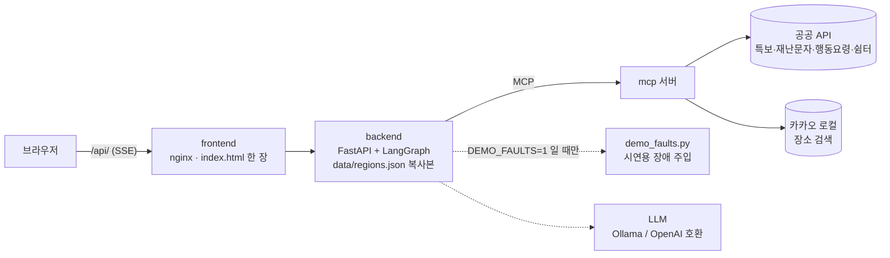
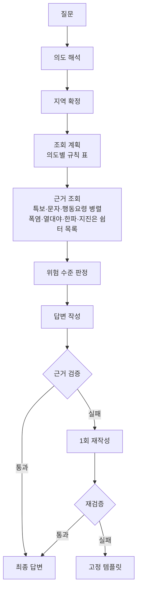

# disaster-advisor — 재난문자 모아보기 · "문자 받았는데 뭘 해야 하나요?"

재난문자를 받고 당황한 시민에게, 우리 동네의 **기상특보·긴급재난문자를 한곳에 모아 보여 주고 공식 행동요령을 근거와 함께 안내**하는 AI 에이전트입니다. 공식 데이터만 근거로 삼고, 근거 검증을 통과한 답변만 내보내도록 설계했습니다. 지역은 전국 시·군(광역시는 시 전체)으로 해석합니다. 저장된 데이터(replay)로 재현되는 상황은 광주광역시·경기도 광주시 중심이고, 다른 지역은 live 모드로 확인합니다.

> 이 서비스는 공식 경보 채널이 아닙니다. 실제 위급 상황에서는 재난문자, 방송, 119 등 공식 안내를 따르세요. 조회에 실패하거나 공식 데이터에 없는 내용은 "정보 없음"으로 표시하며, 이는 안전하다는 뜻이 아닙니다.

## 하는 일
- 지역을 말하면 **발효 중인 특보와 최근 긴급재난문자**를 공식 API로 조회해 위험 수준을 판정합니다.
- 재난 유형에 맞는 **공식 행동요령**을 근거 번호(`[E#]` 특보, `[M#]` 문자, `[G#]` 행동요령, `[S#]` 쉼터·대피장소)와 함께 보여 줍니다.
- 장소 이름을 말하면 지역을 찾고 카카오맵 링크 칩을 붙입니다(경로 안내·안전 경로 판단은 하지 않습니다).
- 조회 실패와 "해당 지역 정보 없음"을 구분하고, 근거 없는 문장은 검증 단계에서 차단합니다.


## 구조


**판정·라우팅·조회 계획·검증은 코드가, LLM은 의도 파악과 답변 작성만** 맡습니다. AI가 낸 값(재난 유형·장소 표현)은 코드가 질문 원문에 근거가 있는지 확인한 뒤에만 씁니다(ADR-023). API 키는 `mcp` 컨테이너에만 전달되고 서버는 상태를 저장하지 않습니다.

### 응답 순서

- 화면은 SSE 이벤트를 네 단계로 보여 줍니다: **판단**(`judgement`, 지역·위험 수준) → **근거**(`evidence`, 공식 데이터 묶음) → **요약 정보**(`quick`, 검증을 통과한 기본 요약) → **최종 답**(`final`, AI 답변이 검증을 통과하면 교체). 정거장 아래에는 실제로 지나간 세부 노드(의도 파악·지역 확정·계획·조회·판정·작성·검증·재작성·고정 양식 전환)가 한 줄씩 보이고, 노드별 시간·검증 위반 사유·장애 주입은 화면의 "개발자 보기"에만 있습니다.
- 백엔드 이미지는 범위 판단용으로 `data/regions.json`만 복사합니다. 시연용 장애 주입(`backend/agent/demo_faults.py`)은 `DEMO_FAULTS=1`일 때만 켜집니다(기본 꺼짐, ADR-021).
- 응급 상황과 범위 밖 질문은 고정 응답으로 분기합니다. 지역은 전국 시·군으로 해석하고(광역시는 시 전체 단위), 같은 이름이 여러 곳이거나 도 이름만 있으면 되묻습니다('광주'는 두 곳을 함께 보여 줍니다). 이전 질문의 지역은 지역을 말하지 않은 질문에만 쓰고, 같은 이름이 여러 곳인 표현에는 쓰지 않습니다.
- 쉼터·대피장소는 공식 목록에 있는 장소로만 안내하고 운영 여부는 단정하지 않습니다. 지도는 카카오맵 링크로만 넘깁니다.
- 설계 배경과 결정 기록은 [`doc/기획서.md`](doc/기획서.md), [`doc/ADR.md`](doc/ADR.md), 문제 해결 기록은 [`doc/트러블슈팅.md`](doc/트러블슈팅.md)에 있습니다.

## 실행
준비물: Docker(Docker Desktop 또는 Docker Engine + compose). 실제 모델을 쓰려면 Ollama, 도커 없이 개발하려면 Python 3.11 이상.
아래 순서대로 한 단계씩 늘려 가면 됩니다. **1단계는 키도 LLM도 필요 없습니다.**

### 1단계. 키 없이 · LLM 없이 (replay + fake)
```bash
git clone https://github.com/DDARK00/disaster-alert-agent.git && cd disaster-alert-agent
cp .env.example .env          # 아무 값도 채우지 않아도 된다
docker compose up --build     # 처음 한 번은 이미지 빌드에 몇 분
```
- http://localhost:8080 을 열고 위쪽 예시 질문(예: "폭염경보 발효 중")을 누릅니다.
- 데이터는 `replay`(저장해 둔 실제 API 응답, `data/fixtures/`), 답변은 `fake`(모델 없이 고정 규칙으로 만든 요약)입니다. 판정·근거·검증 흐름은 실제와 같고, 답변 문장만 템플릿입니다.
- 확인: `curl http://localhost:8080/api/health` → `"llm":"fake"`, `"data_mode":"replay"`, `"mcp":true`.
- 컨테이너 3개: `mcp`(:8200), `backend`(:8100), `frontend`(:8080). 호스트에 열리는 포트는 8080뿐이고 백엔드는 `/api/`로 접근합니다. 키는 `mcp`에만 전달됩니다.

### 2단계. 실제 모델 붙이기 (replay + LLM)
`LLM_BACKEND=openai_compat`은 OpenAI 모델이라는 뜻이 아니라 **OpenAI 호환 API 형식**이라는 뜻입니다. 로컬 Ollama와 호스팅 API 모두 이 형식입니다.
```bash
ollama pull qwen3:8b          # Ollama 앱(또는 ollama serve)이 켜져 있어야 한다
```
`.env`에서 두 줄을 바꿉니다.
```
LLM_BACKEND=openai_compat
LLM_MODEL=qwen3:8b
```
```bash
docker compose up -d          # .env 를 바꾼 뒤에는 다시 올리면 된다 (코드를 바꾼 게 아니면 --build 불필요)
```
- 확인: `/api/health` → `"llm":"openai_compat:qwen3:8b"`. 답변 위 출처 줄이 "AI 답변 · 근거 검증 통과"로 바뀝니다(검증을 통과하지 못하면 검증된 기본 요약이 그대로 남습니다).
- 컨테이너 안에서는 호스트 Ollama를 `host.docker.internal:11434`로 부릅니다(`LLM_BASE_URL_DOCKER`). Linux에서는 Ollama를 `OLLAMA_HOST=0.0.0.0`으로 띄워야 합니다.
- 호스팅 API를 쓰려면 `LLM_BASE_URL_DOCKER`, `LLM_MODEL`, `LLM_API_KEY`를 채웁니다. qwen3:8b 기준으로 답변 하나에 수십 초가 걸리며, 그동안 화면에는 검증된 기본 요약이 먼저 보입니다.

### 3단계. 지금 특보 보기 (live, 공공 API 키 필요)
- [부록 1](#1-필요한-키--데이터가-얼마나-흩어져-있는가)의 키를 `.env`에 채우고 `docker compose up -d`.
- 화면의 "데이터"를 `live`로 바꾸거나, 기본값을 바꾸려면 `.env`의 `DATA_MODE=live`.
- 키가 없거나 거부된 소스는 그 부분만 "정보 없음"(원인별 문구)으로 표시되고 나머지는 정상으로 답합니다. 카카오 키(`KAKAO_REST_API_KEY`)가 없으면 장소 이름 검색만 빠지고, 지역 이름으로는 그대로 찾습니다.
- 지원 지역은 전국 시·군입니다(replay로 재현되는 상황은 광주 두 곳 중심).

### 시연용 장애 주입 (선택)
원인별 "정보 없음" 문구를 화면에서 보여 줄 때만 켭니다. 공개 배포에서는 켜지 않습니다(ADR-021).
```bash
DEMO_FAULTS=1 docker compose up -d backend   # 화면 "개발자 보기" → 오류 주입 선택이 활성화
docker compose up -d backend                 # 끝나면 다시 끈다 (기본 0)
```

### 도커 없이 실행 (개발용)
```bash
sh/setup_venv.sh              # .venv 생성 + 의존성 설치
sh/run_local.sh               # 백엔드만 http://localhost:8100 (MCP 서버는 하위 프로세스로 함께 뜬다, replay + fake 기본)
```
- 화면은 `frontend/index.html`을 브라우저로 열고 주소 뒤에 `?api=http://localhost:8100`을 붙입니다.
- 실제 모델: `LLM_BACKEND=openai_compat LLM_MODEL=qwen3:8b sh/run_local.sh` (로컬은 `LLM_BASE_URL`, 기본 `http://localhost:11434/v1`). `LLM_BACKEND`·`DATA_MODE`는 스크립트가 먼저 기본값(fake·replay)을 정하므로 `.env`가 아니라 이렇게 명령줄로 줍니다. 그 밖의 값(키, `LLM_MODEL` 등)은 `.env`에서 읽습니다(셸에 이미 있는 값이 우선).

### 테스트 · 평가
```bash
sh/test.sh                                         # 단위 테스트 (MCP·백엔드). 키·LLM·도커 필요 없음
.venv/bin/python eval/run_eval.py                  # 평가 세트 — 기본은 도커(http://localhost:8080/api)에 질문
.venv/bin/python eval/run_eval.py --base http://localhost:8100   # 도커 없이 띄운 백엔드에
.venv/bin/python eval/run_scenarios.py [--live]    # 시연 시나리오 (--live 는 키 필요)
```
- 평가는 질문을 보낸 서버의 설정(fake/실제 모델)으로 채점됩니다. 장애 주입 항목만 프로세스 안에서 돌고 셸의 `LLM_*`를 따릅니다(없으면 fake).
- 평가할 때는 `DEMO_FAULTS`를 끈 서버를 씁니다.

## 폴더
| 경로 | 내용 |
|---|---|
| `backend/` | FastAPI, LangGraph 에이전트(판정·검증 포함) |
| `mcp_server/` | MCP 서버: 공공 API 접근, 지역 해석, 쉼터 목록, 카카오 장소 조회 (`tools/`: 지역 데이터 생성) |
| `config/`, `prompts/` | 설정, 규칙, 프롬프트와 고정 문구 |
| `data/` | 지역(전국 생성본)·재난 유형 매핑, 특보구역표, 특보·문자·행동요령·쉼터 fixture |
| `eval/` | 평가 세트와 실행기 |
| `frontend/` | 정적 웹 UI |
| `doc/` | 기획서, ADR, API 스키마, 운영 문서 |

## 데이터 출처
- 기상청 기상특보 조회서비스 (공공데이터포털)
- 행정안전부 긴급재난문자, 국민행동요령(자연·사회·생활안전·민방위), 통합대피소 (재난안전데이터공유플랫폼)
- 카카오 로컬 API (장소 검색, 응답은 저장하지 않음)

각 데이터의 이용조건은 제공기관 표기를 따릅니다. 긴급재난문자는 출처표시·상업적 이용 금지·변경 금지 조건이 있어, 이 저장소는 API 활용신청 때 밝힌 대로 **학습용(비상업)** 프로젝트입니다.

## 부록. 포팅 방법

### 1. 필요한 키 — 데이터가 얼마나 흩어져 있는가
시민이 문자를 받고 행동을 알아내는 데 필요한 공식 정보는 **발급처 3곳, API 8개, 키 8개**로 나뉘어 있습니다. 이 프로젝트가 한 번의 질문으로 합치는 대상입니다.

| 환경변수 | 발급처 | 용도 |
|---|---|---|
| `WEATHER_ALERTS_SERVICE_KEY` | 공공데이터포털 | 기상특보 |
| `DSSP_MESSAGE_SERVICE_KEY` | 재난안전데이터공유플랫폼 | 긴급재난문자 |
| `DSSP_GUIDE_NATURAL_SERVICE_KEY` | 재난안전데이터공유플랫폼 | 행동요령 · 자연재난 |
| `DSSP_GUIDE_SOCIAL_SERVICE_KEY` | 재난안전데이터공유플랫폼 | 행동요령 · 사회재난 |
| `DSSP_GUIDE_LIFE_SERVICE_KEY` | 재난안전데이터공유플랫폼 | 행동요령 · 생활안전 |
| `DSSP_GUIDE_CIVIL_DEFENSE_SERVICE_KEY` | 재난안전데이터공유플랫폼 | 행동요령 · 민방위 |
| `DSSP_SHELTER_SERVICE_KEY` | 재난안전데이터공유플랫폼 | 통합대피소 |
| `KAKAO_REST_API_KEY` | 카카오 디벨로퍼스 | 장소 검색 |

8개 모두 서로 다른 키입니다. 선택 항목: `LANGSMITH_*`(관측성), `LLM_*`(모델), `DATA_MODE`·`MAX_REWRITES`·`DEMO_FAULTS` 등(`.env.example`에 기본값).

### 2. 이식할 때 알아둘 것
- **호출 한도**: 재난안전데이터공유플랫폼 API는 API당 하루 1,000건입니다. live에서 행동요령은 하루 1회, 쉼터 목록은 (지역, 구분) 단위로 6시간 캐시합니다(`config/rules.yaml` `cache_hours`).
- **지원 지역**: `data/regions.json`은 특보구역표에서 생성합니다(`mcp_server/tools/gen_regions.py`, 입력 `data/region_build.yaml`). 재난 유형은 `data/hazard_map.json`, 쉼터 조회 범위는 지역별 `shelter_area`(생성 지역마다 시도 단위 위경도 범위 + 주소 접두어, T-037)로 정합니다. 저장된 특보 fixture(replay)는 데모 지역 중심이라 다른 지역은 live 모드로 확인합니다.
- **LLM 교체**: `.env`의 `LLM_*` 값만 바꿉니다. 판정·검증은 코드라 모델을 바꿔도 안전 규칙은 그대로입니다.
- 키는 `.env`에만 두고 커밋하지 않습니다(`.gitignore` 제외).
